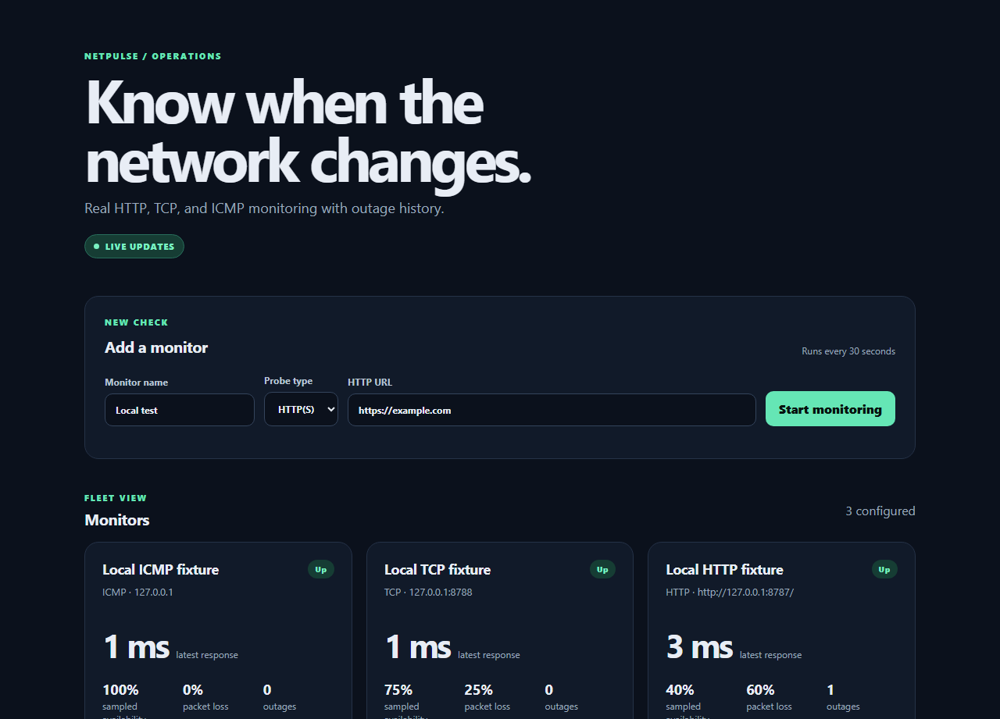
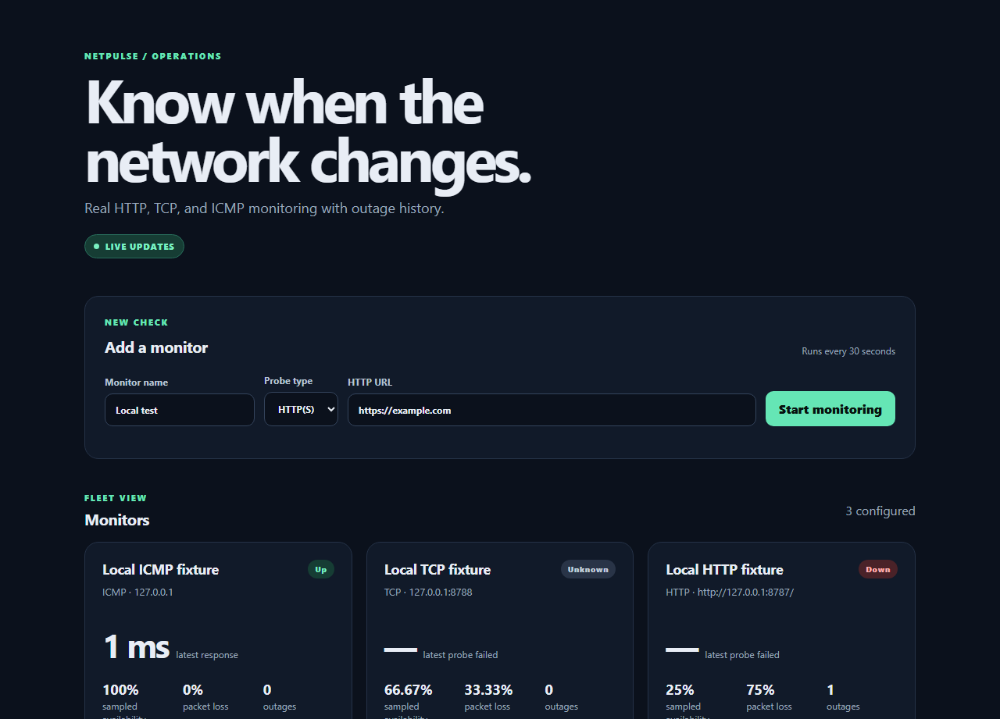
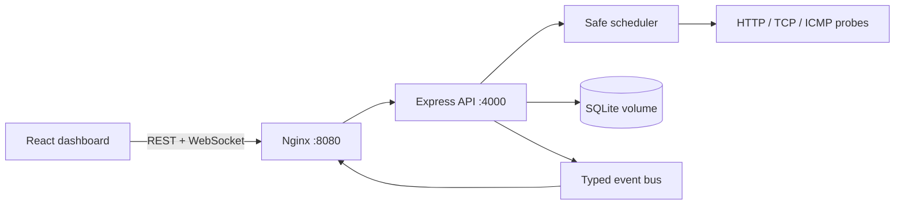

# NetPulse

Local-first network monitoring for developers who want to understand the reliability of the services they depend on.

> **Current status:** Milestones 1 through 7 are implemented on the development branch. NetPulse monitors HTTP(S), TCP, and ICMP targets, stores real measurements in SQLite, tracks outages, shows selectable history, and includes local security/operational hardening, Docker packaging, CI verification, and release documentation. Public deployment remains out of scope.

Security review status is documented in [`docs/security-audit.md`](./docs/security-audit.md).
The application is suitable for local development and local Docker use only;
public release remains blocked by the absence of authentication, TLS, and
public-deployment controls.

## Project Overview

NetPulse is a portfolio project for measuring network reachability from a local Windows machine. It periodically performs real HTTP, TCP, or ICMP checks against configured targets, records whether each probe succeeded, measures latency, and keeps the results in a local SQLite database.

The project is intended to make common monitoring questions easy to answer:

- Is a service reachable right now?
- How long does the latest request take?
- How often have completed checks failed?
- Did the API restart without losing previous measurements?
- Can a monitoring target be configured without accidentally probing private or local services?

NetPulse is designed for:

- Students learning full-stack TypeScript and networking fundamentals.
- Developers building a small personal or portfolio monitoring tool.
- Anyone who wants a transparent, local alternative to a hosted monitoring service during development.

It is currently a single-user application intended to run on `localhost`. It does not provide hosted monitoring or remote agents.

## Portfolio evidence

These screenshots were captured from the running application using isolated
local HTTP and TCP fixtures plus Windows ICMP loopback monitoring. They show
real persisted measurements, compact latency charts, and a controlled outage
history; no simulated dashboard data was used.





## Planned Features

The long-term vision is a practical network monitoring dashboard with multiple probe types, historical analysis, outage detection, and real-time updates.

| Area | Current implementation | Planned |
| --- | --- | --- |
| HTTP monitoring | Real HTTP(S) probes with latency, status, timeout, and response-size limits | More detailed HTTP history and configurable policies |
| Storage | SQLite via Prisma | Retention jobs and larger-scale storage options |
| Dashboard | React dashboard with latest result, history windows, and compact measurement charts | Richer analytics and visualizations |
| Probe types | HTTP(S), TCP connect, and ICMP | Additional probe policies and richer diagnostics |
| Updates | REST is authoritative; WebSocket notifications trigger targeted reloads and reconnect sync | Broader real-time event coverage |
| Reliability | Per-monitor scheduling, one in-flight probe, and persisted outage transitions | Maintenance windows and alert policies |
| Operations | Local Windows development workflow | CI, Docker, and deployment documentation |
| Notifications | Not available | Alerting and notification channels |

Only the current implementation described below should be treated as available.

## Current Status: Milestone 7

Milestone 1 delivers the smallest runnable HTTP monitoring vertical slice:

- React/Vite frontend with a minimal monitor form and status cards.
- Express/TypeScript API bound to `127.0.0.1:4000`.
- Real HTTP(S) requests using Node's HTTP/HTTPS client APIs.
- Immediate probing after monitor creation, followed by a 30-second schedule.
- One in-flight probe per monitor to avoid overlapping requests.
- SQLite persistence through Prisma migrations.
- Latest latency, HTTP status, success/failure, and probe error information.
- Sampled availability and packet-loss statistics:
  - **Packet loss:** failed completed probes divided by completed probes.
  - **Sampled availability:** successful completed probes divided by completed probes.
  - Missing measurements and paused periods are not counted as downtime.
- Input validation for monitor names, URL syntax, supported schemes, ports, credentials, URL length, intervals, and timeouts.
- SSRF protections that block loopback, private, link-local, multicast, reserved, and unsafe IPv6 targets by default.
- Explicit development/test-only loopback support for local fixtures through `NETPULSE_ALLOW_LOCAL_TARGETS=true`.
- DNS validation and connection using the validated address to reduce DNS-rebinding risk.
- Hard probe timeouts and response-body size limits.

The current automated verification includes target-validation tests, IPv6 and DNS-rebinding regression tests, timeout tests, response-size tests, redirect behavior, failed HTTP status handling, API health tests, TypeScript checks, production builds, and deterministic Playwright browser tests using an isolated local fixture.

Milestone 2 adds:

- A local `/ws` WebSocket endpoint integrated with the API HTTP server.
- Typed `connection.ready` and `measurement.completed` event contracts.
- Events broadcast only after the measurement has been persisted in SQLite.
- Origin checks, connection limits, and WebSocket payload limits.
- A browser client with Live, Reconnecting, and Offline status.
- Bounded exponential reconnection backoff.
- REST synchronization on initial connection, reconnect, and measurement notifications.

Milestone 3 adds:

- TCP connectivity checks using Node's `net` socket API.
- Configurable TCP ports with monotonic connection latency measurement.
- TCP DNS, refusal, timeout, and connection-error classification.
- ICMP checks using the operating system `ping` utility without shell interpolation.
- Windows-compatible `ping.exe` arguments and graceful unsupported/permission/unreachable errors.
- HTTP, TCP, and ICMP monitors sharing the same scheduler, measurement storage, sampled statistics, and WebSocket notifications.
- Monitor creation fields that change based on the selected probe type.

Milestone 4 adds:

- Selectable 1-hour, 6-hour, 24-hour, 7-day, and 30-day history windows.
- Historical measurement and outage REST data for each monitor.
- Compact dashboard history charts showing successful and failed samples.
- Consecutive-failure outage detection with persisted start, end, failure count, and reason.
- Duration-based availability when an outage record exists, alongside clearly labeled sampled availability.
- Configurable bounded retention pruning for old measurements and closed outages.
- REST history pagination and server-side latency, probe, loss, availability, and outage statistics.
- WebSocket outage-start, outage-recovery, and monitor-status events after persistence.

Milestone 5 adds:

- Security response headers, strict local-origin CORS, request IDs, bounded JSON bodies, and an in-process API rate limit.
- Structured JSON request, error, lifecycle, scheduler, and retention logs without logging target credentials or response bodies.
- Resilient scheduler error isolation, periodic cleanup error handling, WebSocket heartbeat cleanup, and graceful shutdown.
- GitHub Actions verification for locked dependency installation, migrations, tests, lint, and production builds.

Milestone 6 adds:

- Startup failure handling and safe shutdown of the scheduler, WebSocket server, HTTP server, and Prisma client.
- A deletion race guard so an in-flight probe cannot persist a measurement after its monitor is removed.
- Dashboard loading, empty, network-error, disabled-action, and reconnecting states.
- Pause/resume and delete controls with confirmation, accessible status labels, responsive form/card layouts, keyboard focus states, and reduced-motion support.
- Clear distinction between live updates, reconnecting, offline, UP, DOWN, PAUSED, and UNKNOWN states.

Milestone 7 adds:

- Multi-stage Docker builds for the API and static dashboard, with a non-root
  API user and persistent SQLite volume.
- Docker Compose startup with health checks, automatic migration deployment,
  restart policy, and WebSocket reverse proxying.
- CI permissions hardening, Docker build checks, dependency audit gating, and
  reproducible release documentation.
- A recommended `v0.1.0` changelog and release checklist.

## Tech Stack

| Technology | Purpose |
| --- | --- |
| Node.js | Runtime for the API, scheduler, and network probes |
| TypeScript | Strict typing across the API and frontend |
| React | Dashboard UI |
| Vite | Frontend development server and production bundler |
| Express | REST API and local HTTP server |
| Prisma | Type-safe database access and migrations |
| SQLite | Local, file-based measurement storage |
| Zod | Request validation and input constraints |
| Vitest | Unit and probe regression tests |
| Supertest | API health endpoint testing |
| npm workspaces | Monorepo dependency and script management |
| `node:http`, `node:https`, `node:dns/promises` | Bounded HTTP probing and target resolution |
| `node:net` | TCP connection probing |
| `node:child_process` | Safe, argument-array invocation of the system ping utility |
| Concurrently | Runs the API and frontend development servers together |

Tailwind CSS and Recharts are part of the longer-term architecture but are not dependencies in the current repository. The current UI uses a small custom stylesheet to keep the MVP dependency-light.

## Architecture



In local development, Vite serves the dashboard on port 5173 and the API binds
to `127.0.0.1:4000`. In Docker Compose, Nginx serves the dashboard on port 8080,
proxies `/api` and `/ws` to the API service, and the API binds to `0.0.0.0`
inside the private Compose network. The host exposes only the Nginx port.

## Installation & First-Time Setup

### Requirements

- Windows with PowerShell.
- Node.js 20 or newer.
- npm 10 or newer.
- A network connection for probing public HTTP(S) targets.

Check your versions:

```powershell
node --version
npm --version
```

### Clone and install

Replace the placeholder URL with the repository URL when cloning from GitHub:

```powershell
git clone <repository-url> NetPulse
Set-Location NetPulse
npm ci
```

### Configure the API

Create the local environment file from the checked-in template:

```powershell
Copy-Item apps/api/.env.example apps/api/.env
```

The default configuration binds the API to `127.0.0.1:4000`, serves the
frontend from port `5173`, and stores SQLite data in
`apps/api/prisma/dev.db`. Docker sets `HOST=0.0.0.0` only inside its private
Compose network.

For normal use, keep this setting disabled:

```dotenv
NETPULSE_ALLOW_LOCAL_TARGETS=false
```

Only enable local loopback targets when running a local HTTP, TCP, or ICMP fixture for development or tests:

```dotenv
NODE_ENV=development
NETPULSE_ALLOW_LOCAL_TARGETS=true
```

The application ignores this override in production and test-target validation remains restricted to loopback addresses when the override is active. Never expose this unauthenticated local application publicly.

### Initialize SQLite

Generate the Prisma client and apply the initial migration:

```powershell
npm run db:generate
npm run db:migrate
```

`npm ci` is preferred for a clean checkout and is used by CI. If your npm
installation blocks package lifecycle scripts, run `npm run db:generate`
explicitly after installation before starting tests or the API.

### Start NetPulse

Run both development servers:

```powershell
npm run dev
```

Then open:

- Dashboard: <http://localhost:5173>
- API health check: <http://localhost:4000/api/health>

To run either process separately:

```powershell
npm run dev:api
npm run dev:web
```

### Docker Compose deployment

Install Docker Desktop with the Linux container engine enabled, then run:

```powershell
Copy-Item .env.example .env
docker compose up --build -d
docker compose ps
docker compose logs -f api
```

Open <http://localhost:8080>. The API is not published directly; Nginx proxies
the dashboard's REST and WebSocket requests. SQLite is stored in the named
`netpulse-data` volume and migrations run non-destructively when the API starts.
Use `docker compose restart` to test recovery and `docker compose down` to stop
services. Do not use `docker compose down -v` unless you intentionally want to
remove the monitoring database.

Back up and restore the named volume from PowerShell:

```powershell
docker run --rm -v netpulse-data:/data -v ${PWD}:/backup alpine `
  tar czf /backup/netpulse-data.tgz -C /data .
docker run --rm -v netpulse-data:/data -v ${PWD}:/backup alpine `
  sh -c "rm -rf /data/* && tar xzf /backup/netpulse-data.tgz -C /data"
```

The Docker image does not grant privileged ICMP access. HTTP and TCP monitoring
remain supported; ICMP may report an unsupported or permission failure depending
on the host and container runtime. Never publish port 4000 or expose this
unauthenticated application directly to the Internet.

## Usage Guide

1. Open <http://localhost:5173>.
2. Enter a monitor name, such as `Example`.
3. Choose `HTTP(S)`, `TCP`, or `ICMP`.
4. Enter the configuration for that probe:
   - HTTP(S): a URL such as `https://example.com`.
   - TCP: a hostname/IP and port such as `example.com` and `443`.
   - ICMP: a hostname/IP such as `example.com`.
5. Select **Start monitoring**.
6. NetPulse performs a real probe immediately, saves the measurement, and repeats the check every 30 seconds.
7. Review the monitor card for the latest status, latency, sampled availability, packet loss, and check time.

### Understanding the dashboard

- **ONLINE** means the latest completed probe succeeded. HTTP requires a `2xx`/`3xx` response, TCP requires a connection, and ICMP requires a ping reply.
- **DOWN** means the latest completed probe failed, timed out, was refused, was unreachable, or exceeded the HTTP response-size limit.
- **WAITING** means no completed measurement is available yet.
- **Latest latency** is measured for the most recent completed request.
- **Sampled availability** is the percentage of completed probes that succeeded. It is not duration-based uptime.
- **Packet loss** is the percentage of completed probes that failed.
- **Duration availability** subtracts persisted outage duration from the selected window; an ongoing outage is bounded at query time.
- **UP**, **DOWN**, **PAUSED**, and **UNKNOWN** are distinct monitor states. Paused monitors do not run probes or create outage records.
- A monitor with no completed probes displays `—` rather than treating missing data as downtime.

### Windows ICMP notes

NetPulse invokes `ping.exe` with an argument array and does not execute a shell command. ICMP availability depends on the local Windows network, firewall, and permissions. A failed or unsupported ICMP probe is stored as a real failed measurement; NetPulse never substitutes simulated latency.

Measurements and completed outages remain in the SQLite database when the API restarts. The dashboard can query a selected history window; retention pruning defaults to 30 days and is bounded to a safe 1-3650 day range.

### History API

`GET /api/monitors/:id/history?hours=24&page=1&pageSize=200` returns bounded measurements, outage records, pagination metadata, and window statistics. `hours` accepts 1-720 and `pageSize` accepts 1-500. API timestamps are UTC ISO-8601 strings and are rendered in the browser's local timezone.

## Development Roadmap

- [x] **Milestone 1 — Secure HTTP monitoring MVP**
  - [x] React/Vite dashboard
  - [x] Express API and SQLite/Prisma persistence
  - [x] Real scheduled HTTP(S) measurements
  - [x] Sampled availability and packet-loss statistics
  - [x] Baseline URL, SSRF, timeout, response-size, and resource validation
  - [x] Unit tests, API test, type checks, and production build
- [x] **Milestone 2 — Reliable real-time updates**
  - [x] WebSocket notifications for completed measurements
  - [x] REST remains authoritative after disconnects and reconnects
  - [x] Client reloads current state to recover missed events
- [x] **Milestone 3 — TCP and ICMP monitoring**
  - [x] TCP connect probing with configurable ports
  - [x] Windows-aware ICMP probing and capability/error reporting
  - [x] Shared scheduling, persistence, statistics, and WebSocket updates
- [x] **Milestone 4 — History and outage analysis**
  - [x] Selectable measurement windows and charts
  - [x] Consecutive-failure outage detection
  - [x] Duration-based availability when outage duration is measured
  - [x] Retention management
- [x] **Milestone 5 — Security and operational reliability**
  - [x] Security headers, strict origin policy, request IDs, body limits, and rate limiting
  - [x] Structured logs, graceful shutdown, scheduler/WebSocket resilience
  - [x] GitHub Actions checks for migrations, tests, lint, and build
  - [x] SSRF regression coverage, including hexadecimal IPv4-mapped IPv6 targets
  - [x] Resolve the Prisma/deepmerge-ts High dependency advisory before public release
- [x] **Milestone 6 — Operational polish and reliability**
  - [x] Startup/shutdown and in-flight deletion reliability
  - [x] Dashboard loading, error, lifecycle, accessibility, and responsive states
  - [x] Regression coverage and verified production build
- [x] **Milestone 7 — Deployment and portfolio release preparation**
  - [x] Multi-stage Docker and Compose packaging with persistent SQLite storage
  - [x] CI Docker-build, audit, test, lint, migration, and production-build checks
  - [x] Installation, backup/restore, changelog, and release checklist documentation
  - [ ] Approve a software license
- [ ] **Future — Browser verification**
  - [ ] Browser end-to-end workflow
- [ ] **Future — Alerts and scale**
  - [ ] Notifications, maintenance windows, and escalation
  - [ ] Remote probe agents and multi-region monitoring
  - [ ] Larger-scale storage and authenticated deployments

## Project Structure

```text
.
├── apps
│   ├── api
│   │   ├── prisma
│   │   │   ├── migrations/       SQLite migration history
│   │   │   └── schema.prisma     Database schema
│   │   └── src
│   │       ├── app.ts            Express routes and validation
│   │       ├── config.ts         Environment configuration
│   │       ├── db.ts             Prisma client
│   │       ├── probe.ts          HTTP probe implementation
│   │       ├── tcp-probe.ts      TCP connection probe
│   │       ├── icmp-probe.ts     System ping integration
│   │       ├── probe-types.ts    Shared probe result types
│   │       ├── scheduler.ts      Scheduled monitor execution
│   │       ├── target.ts         URL, DNS, and SSRF validation
│   │       └── server.ts         API startup and shutdown
│   └── web
│       └── src
│           ├── main.tsx          React dashboard
│           └── style.css         Dashboard styling
├── package.json                  Root workspace scripts
├── package-lock.json             Locked npm dependencies
└── tsconfig.base.json            Shared TypeScript settings
```

## Verification Commands

Run these from the repository root:

```powershell
npm test
npm run lint
npm run build
```

The current suite includes 35 passing API, configuration, target-validation,
HTTP/TCP/ICMP probe, outage-state, scheduler-ordering, WebSocket, and
operational-resilience tests. The production build creates the API output in
`apps/api/dist` and the frontend output in `apps/web/dist`.

The CI workflow runs these checks plus Docker image builds and
`npm audit --omit=dev --audit-level=high`. Prisma 7 uses the
`better-sqlite3` adapter and the production audit currently reports zero
vulnerabilities.

## Known Limitations

- Probe behavior depends on the target network: firewalls can block TCP or ICMP even when HTTP works.
- The application is local-only and has no authentication or multi-user support.
- WebSocket notifications are implemented, but REST remains authoritative and is used to recover missed updates.
- The dashboard history chart is intentionally compact and not a full analytics/charting suite.
- Sampled availability remains the default probe-based statistic; duration availability begins when a persisted outage is detected.
- Outages require the configured consecutive-failure threshold (three by default), so isolated failures do not create outage duration.
- DNS-specific, UDP, traceroute, TLS-expiry, and browser-journey checks are not implemented.
- Duration-based availability only reflects persisted outages after the failure threshold; it is not a full SLO or maintenance-aware calculation.
- The scheduler runs in the API process and is not designed for horizontal scaling.
- SQLite is suitable for this single-user local MVP, not for concurrent multi-instance production monitoring.
- Public deployments require additional authentication, origin/CSRF review, rate limiting, secret management, and operational hardening.
- Docker Compose is a local deployment package, not a public security boundary;
  it has no authentication and should remain behind a trusted host firewall or
  an authenticated TLS reverse proxy.
- The recommended first version is `v0.1.0`; see [`CHANGELOG.md`](./CHANGELOG.md)
  and [`docs/release-checklist.md`](./docs/release-checklist.md).
- Closed measurements and outages older than `RETENTION_DAYS` (30 by default) are removed hourly; active outages are preserved until recovery.
- The API emits JSON logs with request IDs; `API_RATE_LIMIT` defaults to 120 requests per minute per client address.
- Startup and shutdown failures are logged as `server.startup_failed` or `server.shutdown_failed`; request failures include the response request ID.
- For diagnostics, run `npm run dev:api` and query `Invoke-RestMethod http://127.0.0.1:4000/api/health` from PowerShell.

### Troubleshooting

- **TCP shows `DNS_ERROR`:** verify the hostname resolves from the machine running NetPulse.
- **TCP shows `REFUSED`:** the host is reachable but no service accepted the configured port.
- **TCP or ICMP shows `TIMEOUT`/`UNREACHABLE`:** check firewalls, VPNs, routing, and whether the target permits that protocol.
- **ICMP shows `UNSUPPORTED` or `PERMISSION`:** verify that `ping.exe` is available and permitted by Windows security policy.
- **A local fixture is blocked:** set `NODE_ENV=development` and `NETPULSE_ALLOW_LOCAL_TARGETS=true`; this override is intentionally not accepted in production.

## License and release scope

NetPulse is released under the [MIT License](./LICENSE). Version `v0.1.0` is
for local installation and trusted-host Docker use only. The application has
no authentication or TLS and must not be exposed directly to the public
Internet.
